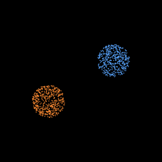
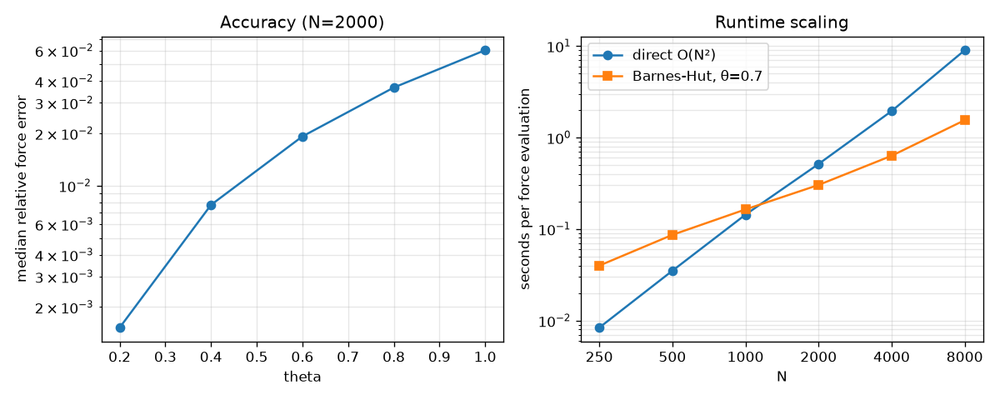

# Barnes-Hut N-body

2D gravitational N-body simulation with a [Barnes-Hut](https://www.nature.com/articles/324446a0) quadtree and kick-drift-kick leapfrog. The script compares the tree against direct O(N²) summation for force error and runtime, then collides two disk galaxies.

[Preview](#preview) · [Method](#method) · [Setup](#setup) · [Run](#run) · [Tests](#test) · [Results](#results)

## Preview



## Method

The tree is built recursively. The force walk handles a whole batch of target bodies at each node: bodies that see the node under the opening angle `theta` take its monopole, and the rest move on to the children. That keeps the code to a single short recursive function and still puts the arithmetic in numpy. Direct summation is vectorized numpy, chunked to limit memory.

## Setup

```bash
pip install -r requirements.txt
```

## Run

```bash
python nbody.py           # benchmark up to N=8000 + 1002-body collision, about 2.5 min
python nbody.py --quick   # smaller benchmark + 302-body collision, about 40 s
```

`--theta` sets the opening angle for the collision run (default 0.7). Outputs are `scaling.png` and `galaxies.gif`.

## Test

Install pytest in addition to the simulation dependencies:

```bash
pip install pytest
```

```bash
python -m pytest -q
```

The tests check that theta=0 reproduces the direct sum to rounding error, that error grows with theta, that momentum is conserved exactly with direct forces and almost exactly with tree forces, and that leapfrog energy error on an eccentric two-body orbit stays bounded over 20 orbits.

## Results



With N=2000 and softening 0.01, the median relative force error is 1.5e-3 at theta=0.2, 1.9e-2 at 0.6 and 6.0e-2 at 1.0. Pure-numpy direct summation wins below about N=1000. At N=8000 the tree takes 1.5 s per force evaluation against about 9 s for direct summation. The 600-step collision run drifts in total energy by 2.4e-4.
